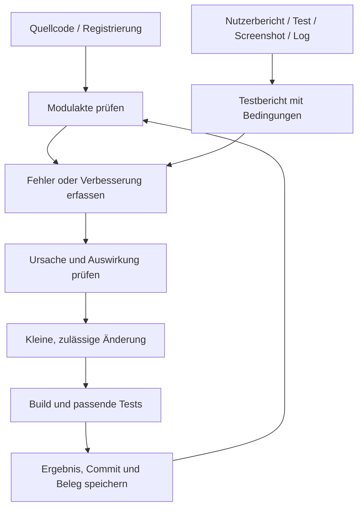

# Nightfall – Qualitäts- und Verbesserungsprojekt

Nightfall ist die zentrale, langfristige Wissens-, Fehler- und Verbesserungsdatenbank für den Client. Sie hält den belegten Zustand jedes registrierten Moduls fest und unterstützt dabei, bestätigte, zulässige Probleme nachvollziehbar zu beheben.

## Grundregeln

- Vor jeder Arbeit den aktuellen Stand von `main`, diese Anleitung, den Modulindex, den Fortschritt und die betreffende Modulakte lesen.
- Nutzerberichte, Code-Funde und reproduzierte Testergebnisse klar voneinander trennen.
- Nichts als getestet oder behoben markieren, wenn kein passender Nachweis vorliegt.
- Ursache und Auswirkungen untersuchen, dann eine kleine, isolierte Änderung durchführen.
- Nach einer Änderung passende Tests/Builds ausführen und Commit sowie Ergebnis dokumentieren.
- Screenshots und Logs nur mit bereinigten, nicht vertraulichen Informationen ablegen. Keine Tokens, Passwörter, Sitzungsdaten oder privaten Kontoinformationen speichern.
- Es gibt keine automatische Telemetrie: Beobachtungen kommen aus Code, Tests und Dateien, die der Nutzer bereitstellt.

## Startstatistik

| Status aus bestehendem Audit | Module | Anteil |
|---|---:|---:|
| Vollständig geprüft | 22 | 21.8 % |
| Teilweise geprüft | 6 | 5.9 % |
| Noch offen | 73 | 72.3 % |
| **Gesamt** | **101** | **100 %** |

**21.8% vollständig geprüft. 27.7 % wurden mindestens teilweise bearbeitet.** Das sind übernommene Prüfstände, keine neuen Tests aus der Einrichtung.

## Projektgrenzen

Nightfall dokumentiert und verbessert allgemeine Codequalität, Stabilität, Bedienoberfläche, Einstellungen, Ressourcenverwaltung, Fehlerbehandlung und legitime Kompatibilität. Es wird nicht verwendet, um Anti-Cheat, Server-Schutzmaßnahmen oder Kicks zu umgehen. Automatisierte Angriffe, Zielauswahl, Aim-, Klick-/Tap-Timing, Kampfsequenzen und entsprechende Ausführungslogik werden nicht optimiert oder zuverlässiger gemacht. Bei solchen Modulen beschränken sich zulässige Arbeiten auf Dokumentation und nicht-kampfrelevante Anzeige- oder Qualitätsfragen.

## Schnellzugriff

- [Modulindex](MODULE_INDEX.md) – alle 101 registrierten Module und ihr Prüfstatus.
- [Fortschritt](PROGRESS.md) – Statistik, Ersteinrichtung und nächste Schritte.
- [Fehler- und Verbesserungsliste](ISSUES/IMPROVEMENT_BACKLOG.md) – zentrale Sammlung mit IDs, Priorität und Status.
- [Testbereich](TESTING/README.md) – Ablauf und [Testbericht-Vorlage](TESTING/TEST_REPORT_TEMPLATE.md).
- [Belegablage](EVIDENCE/README.md) – Screenshots und Logs.
- [Modulakten](MODULES/) – eine Seite je registriertem Modul.

## Arbeitsablauf

## Beleg- und Statussprache

- **Nutzerbericht, ungeprüft:** vom Nutzer beschrieben, noch nicht unabhängig reproduziert.
- **Code-Fund:** aus dem aktuellen Quellcode abgeleitet; kein Beweis für Verhalten im Spiel.
- **Reproduziert:** unter dokumentierten Bedingungen wiederholt beobachtet.
- **Bestätigter Fehler:** Ursache und tatsächlicher Fehler sind ausreichend belegt.
- **Behoben:** Änderung vorhanden und mit passendem Test/Build überprüft.
- **Offen:** wichtige Bedingungen oder Nachweise fehlen.

Die Modulprüfstände werden aus dem bestehenden `MODULE_AUDIT_PROGRESS.md` übernommen. Die neuen Modulakten sind zunächst strukturierte Dokumentationsgerüste; dadurch wird kein neues In-Game-Testing behauptet.
